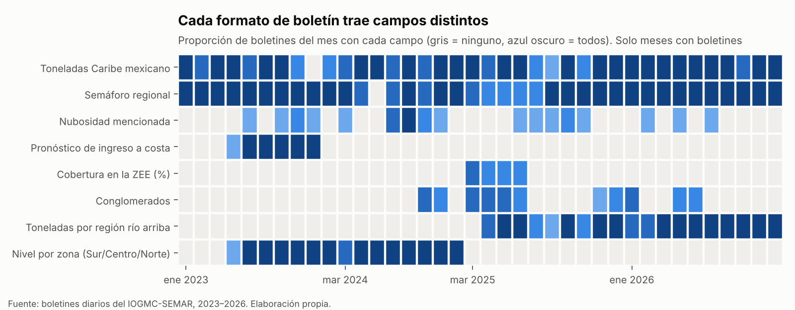
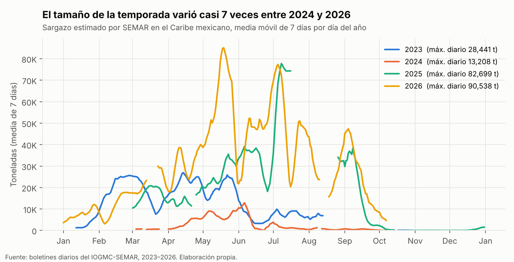
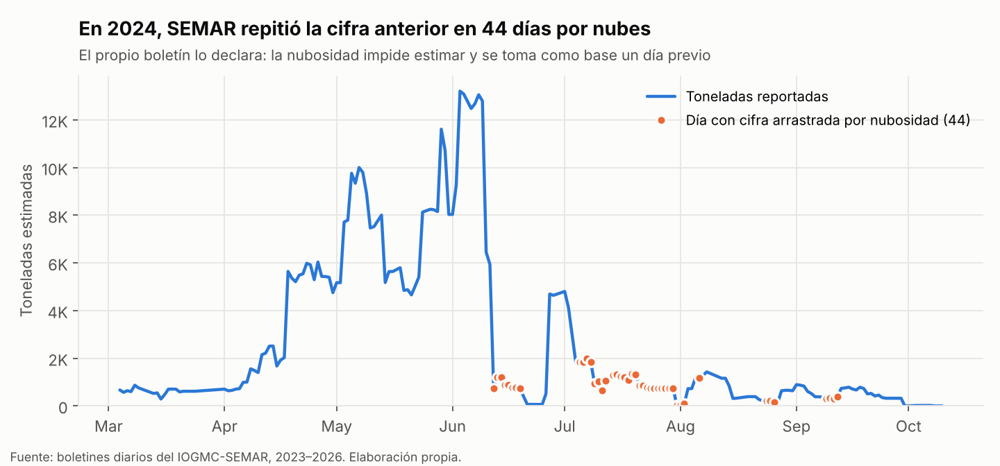
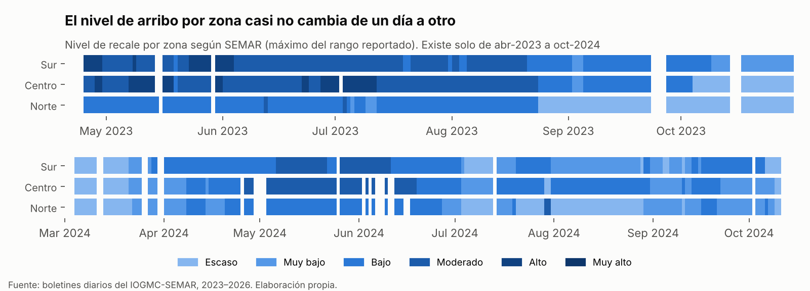
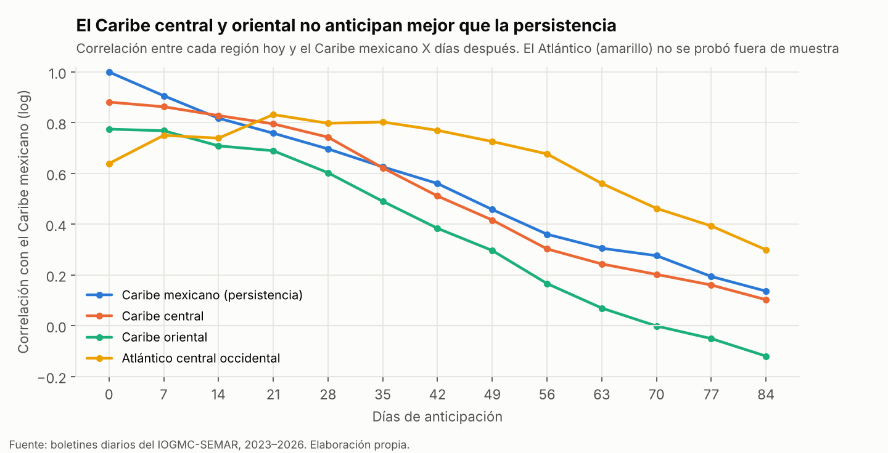

# SEMAR daily sargassum bulletins, 2023–2026, as a table

**English** · [Español](README.es.md)

This repository turns the **1,053 daily bulletins** on sargassum in the Mexican Caribbean, published as PDFs by the Oceanographic Institute of the Gulf and Caribbean Sea of Mexico's Navy (IOGMC-SEMAR), into tabular data. Coverage runs from January 12, 2023 to October 9, 2026.

Until now this information existed only as one PDF per day, in five different formats over time. Here it is available as two analysis-ready tables, with the code to reproduce them and a review of what the data can and cannot support.

**Author:** Maximiliano Macías Herrera, Industrial Engineering, UNAM (Mexico).
**Original source:** [SEMAR daily sargassum bulletins](https://diredimoat.semar.gob.mx/OpSargazo/SargazoBoletinDiario.html) (in Spanish).

> Figures, column names and the data dictionary are in Spanish, matching the source bulletins. Key terms are translated below.

---

## Contents

| File | Description |
|---|---|
| [`datos/boletines_diarios.csv`](datos/boletines_diarios.csv) | One row per bulletin: estimated tonnage, alert level, upstream regions, cloud cover, sargassum patches |
| [`datos/niveles_por_zona.csv`](datos/niveles_por_zona.csv) | Beaching level by coastal zone (South, Center, North) and day, Apr 2023 – Oct 2024 |
| [`datos/diccionario.md`](datos/diccionario.md) | Column definitions and the alert scale (Spanish) |
| `sargazo_semar.py` | Downloads the PDFs, repairs broken links and extracts the fields |
| `preparar_datos.py` | Cleans the extraction and writes the published tables |
| `figuras.py` | Generates the figures and the lead-time test shown below |

### Coverage

| Field | Bulletins with data |
|---|---|
| Tonnage in the Mexican Caribbean (`toneladas_caribe_mexicano`) | 913 |
| Regional alert level, 8-step scale (`semaforo`) | 943 |
| Tonnage in upstream regions: Central Caribbean, Eastern Caribbean, West-Central Atlantic | 441 (from Apr 2025) |
| Beaching level by zone, South / Center / North | 376 full days (Apr 2023 – Oct 2024) |
| Forecast tonnage reaching the coast (`pronostico_ingreso_costa_ton`) | 154 (Apr – Sep 2023) |
| Value carried over because of cloud cover (`dato_arrastrado_por_nubes`) | 47 |



The online archive covers January–October 2023, March–October 2024, March–December 2025 and January–October 2026. Bulletin numbering (January 12, 2023 is No. 491) shows that earlier bulletins exist but are not published.

---

## Findings

### 1. Season size varies widely from year to year

The highest daily estimate was 28,441 t in 2023, 13,208 t in 2024, 82,699 t in 2025 and 90,538 t in 2026.



### 2. Cloud censoring is documented in the bulletins themselves

When cloud cover prevents an estimate, the bulletin says so and reuses an earlier day's figure. In 2024 this happened on 44 days, mostly between June and September. Those days are flagged in `dato_arrastrado_por_nubes`: during those periods the official series is not an independent daily measurement.



### 3. Beaching levels by zone are highly persistent

Between April 2023 and October 2024, the reported level changed only 28 to 40 times per zone over ~380 days. "Tomorrow equals today" is almost always right, which sets a very demanding baseline for any short-term forecast. SEMAR stopped publishing levels by zone in 2025.



### 4. Upstream regions do not give earlier warning (negative result)

I tested whether tonnage in the Central and Eastern Caribbean improves the 28-, 42- and 56-day forecast of the Mexican Caribbean, compared with using the Mexican Caribbean alone. The rule was set before looking at the data: the improvement had to be at least 10%.

| Days ahead | Persistence | Mexican Caribbean only | + Central and Eastern Caribbean | Improvement |
|---|---|---|---|---|
| 28 | 0.649 | 0.843 | 0.717 | −10% |
| 42 | 0.586 | 1.459 | 1.397 | −139% |
| 56 | 0.825 | 2.118 | 1.960 | −137% |

*Mean absolute error of log(1 + tonnes). Trained on 2025, evaluated on 2026.*

It fails. Models fitted on the 2025 season break down in 2026, which was much larger: a year and a half of regional data is not enough to estimate a stable relationship.



The West-Central Atlantic shows high correlations at 28–56 days, but it was **not tested out of sample** and may only reflect the shared seasonal cycle. It remains a hypothesis to evaluate with the 2027 season.

---

## Limitations

- **These are SEMAR assessments, not independent measurements.** Tonnage comes from the University of South Florida's 7-day satellite composite (AFAI index). The alert level and the zone levels combine that tonnage with currents, winds and daily beach photographs from the Federal Maritime-Terrestrial Zone office (ZOFEMAT) of Quintana Roo.
- **Extraction errors.** Four tonnage values that change more than 8× relative to their neighbors are flagged as `sospechoso` (suspect) and excluded from the figures. Six zone levels with a truncated range (e.g., "De alto") are flagged in `qc_nivel`.
- **Gaps.** About 56 bulletins do not exist on the server under any name tried (mostly Oct 11–31, 2024 and Mar 14–21, 2026). Nine PDFs with no text or date (`SIN_INFORMACION_*.pdf`) were excluded.
- **Reconstructed alert scale.** The 1–8 ordering (Escaso, Muy bajo, Bajo, Moderado, Alto, Muy alto, Abundante, Excesivo — roughly Scarce to Excessive) was inferred from category–level pairs that appear together in the bulletins; it does not come from an official SEMAR document.

## Reproduce

```bash
pip install requests beautifulsoup4 pdfplumber matplotlib
python sargazo_semar.py descargar     # ~1,100 PDFs, ~30 min
python sargazo_semar.py recuperar     # repairs misspelled links on SEMAR's page
python sargazo_semar.py inventario    # extracts fields to inventario.csv and zonas.csv
# copy inventario.csv and zonas.csv into datos/crudos/
python preparar_datos.py
python figuras.py
```

## License and citation

- Code: MIT.
- Derived tables: CC BY 4.0. When using them, cite this repository **and** the original source (IOGMC-SEMAR).

> Macías Herrera, M. (2026). *SEMAR daily sargassum bulletins, 2023–2026, as a table* [Dataset and code]. GitHub. https://github.com/Maxtlihuac/sargazo-semar-boletines

If you work at SEMAR, LANOT or another institution and have beach-level arrival records (for example from ZOFEMAT or SIMSAR), I would be glad to talk: that is the data needed to validate forecasts and operational decisions.
